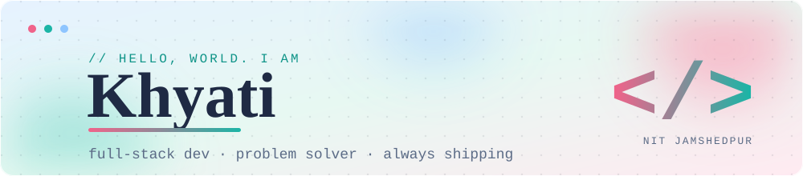

<div align="center">
  
</div>

<br/>

<div align="center">
  
  <a href="https://github.com/sinhakhyati21?tab=followers"></a>
  <a href="https://www.linkedin.com/in/khyati-sinha-906167379"></a>
  <a href="mailto:sinhakhyati21@gmail.com"></a>
</div>

---

## `~/about`

```yaml
name:      Khyati
studying:  B.Tech, Computer Science @ NIT Jamshedpur
batch:     2029
focus:     full-stack web, DSA, ML
mode:      learn → build → break → fix → repeat
```

- 🛠️ I build web apps end to end, from the UI to the database and auth
- 🧩 Sharpening problem-solving and data structures on the side
- 🌱 Currently levelling up in machine learning and backend engineering

---

## `~/toolbox`

**Languages**


**Web & backend**


---

## `~/stats`

<div align="center">
  
  
  <br/>
  
</div>

---

## `~/connect`

I'm happy to talk code, hackathons, or a good bug hunt. You can reach me on [LinkedIn](https://www.linkedin.com/in/khyati-sinha-906167379) or at [sinhakhyati21@gmail.com](mailto:sinhakhyati21@gmail.com).

<div align="center">
  <sub><code>while (alive) { learn(); build(); }</code></sub>
</div>
